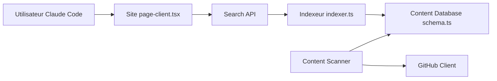

# davepoon/buildwithclaude

> Marketplace and index of plugins, agents, commands and hooks for Claude Code.

## The problem
Claude Code extensions are scattered; finding and installing the right ones takes time.

## What it actually does
The repository serves as a plugin marketplace: 117 agents, 175 commands, 28 hooks, 26 skills and 51 plugins grouped by category. The buildwithclaude.com site, built with Next.js, lets you search (Meilisearch index), read the sheets and copy install commands; an indexer feeds the database from GitHub. Each plugin is a Markdown file with its header.

## How it is wired


## Trying it
```bash
/plugin marketplace add davepoon/buildwithclaude
/plugin search @buildwithclaude
/plugin install agents-python-expert@buildwithclaude
```

## Cost and gotchas
Free. Third-party agents, commands and hooks run with your Claude Code's permissions: read the content before installing, especially hooks. The README's counts are the author's own.

## What it is not
Not a validated or audited set: it is a community collection, quality varies. The site and its indexer are a separate service from the installable content.

## Alternatives
The README cites a companion index list, Vexilo, presented as a visual guide to Claude Code.

## For you
Worth watching as a catalog to pick agents and commands from; install piece by piece after reading, not in bulk.
