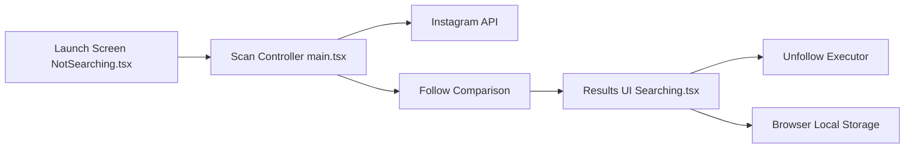

# davidarroyo1234/InstagramUnfollowers

> Browser console script that lists the Instagram accounts that do not follow you back.

## The problem
Instagram does not simply show who does not follow you back; checking by hand takes a long time.

## What it actually does
A script pasted into the console of a browser logged into Instagram. It fetches the following and followers lists through the web API, compares them, displays non-reciprocal accounts live, supports a whitelist (JSON export/import) and unfollowing by selection. Local cache of the last scan, adjustable delays, pause on HTTP 429 or `feedback_required`. Everything runs on the browser side.

## How it is wired


## Trying it
```bash
npm install
npm run build
npm run build-dev
```
(Usage: copy the code from the tool's page, paste it into the Instagram console — `Ctrl+Shift+J`.)

## Cost and gotchas
Free but requires a logged-in Instagram account. Mass unfollowing through the unofficial API exposes the account to action blocks. Do not edit `public/index.html` (regenerated by CI).

## What it is not
Not an official Instagram application or service; it depends on the web API and may break with every change.

## Alternatives
No alternative named in the README.

## For you
Outside the data/AI/MLOps scope and risky for your account (unofficial API): ignore.
