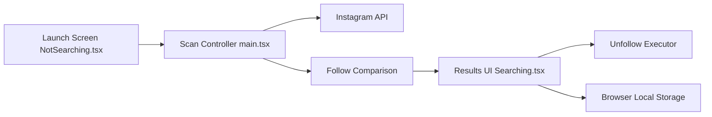

# davidarroyo1234/InstagramUnfollowers

> Script de console navigateur qui liste les comptes Instagram qui ne vous suivent pas en retour.

## Le problème
Instagram n'affiche pas simplement qui ne te suit pas en retour ; le vérifier à la main est long.

## Ce que ça fait vraiment
Un script collé dans la console du navigateur connecté à Instagram. Il récupère les listes following et followers via l'API web, les compare, affiche les non-réciproques en direct, permet une liste blanche (export/import JSON) et de désabonner par sélection. Cache local du dernier scan, délais réglables, pause sur HTTP 429 ou `feedback_required`. Tout s'exécute côté navigateur.

## Comment c'est branché


## Essayer
```bash
npm install
npm run build
npm run build-dev
```
(Usage : copier le code depuis la page de l'outil, le coller dans la console Instagram — `Ctrl+Shift+J`.)

## Coût et pièges
Gratuit mais exige un compte Instagram connecté. Le désabonnement en masse via l'API non officielle expose le compte à des blocages d'action. Ne pas éditer `public/index.html` (régénéré par CI).

## Ce que ce n'est pas
Pas une application ni un service officiel Instagram ; il dépend de l'API web et peut casser à chaque changement.

## Alternatives
Aucune alternative nommée dans le README.

## Pour toi
Hors périmètre data/IA/MLOps et risqué pour ton compte (API non officielle) : à ignorer.

