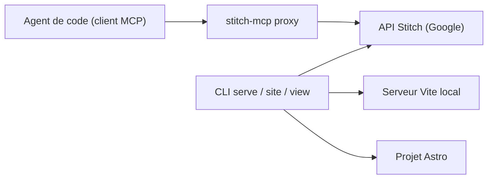

# davideast/stitch-mcp

> CLI and MCP proxy that bring mockups generated by Google Stitch to your machine and your coding agents.

## The problem
Screens generated in Stitch live behind an API as HTML/CSS; previewing them, building a site from them or handing them to an agent takes manual work.

## What it actually does
It serves the screens on a local Vite server, generates an Astro site by matching screens to routes, and exposes the Stitch tools to your agent via an MCP proxy. Three virtual tools are added: `build_site`, `get_screen_code`, `get_screen_image`. Authentication goes through gcloud or a `STITCH_API_KEY` key.

## How it is wired
Simplified diagram based on the sheet, no diagram provided.



## Trying it
```bash
npx @_davideast/stitch-mcp init
npx @_davideast/stitch-mcp serve -p <project-id>
npx @_davideast/stitch-mcp site -p <project-id>
```

## Cost and gotchas
You need a Google Cloud project with billing and the Stitch API enabled ("Permission Denied" error otherwise). Authentication ships an isolated gcloud.

## What it is not
Not a Google product: the author declares the project independent, with no warranty and no promise of maintenance. It does not generate designs, it carries those from Stitch.

## Alternatives
No alternative cited in the README.

## For you
Watch: useful only if you already use Stitch with a coding agent; depends on a third-party API and is an experimental project.
