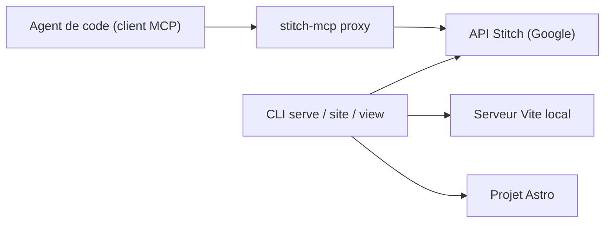

# davideast/stitch-mcp

> CLI et proxy MCP qui amènent les maquettes générées par Google Stitch vers ton poste et tes agents de code.

## Le problème
Les écrans générés dans Stitch vivent derrière une API sous forme de HTML/CSS ; les prévisualiser, en tirer un site ou les donner à un agent demande du travail manuel.

## Ce que ça fait vraiment
Il sert les écrans sur un serveur Vite local, génère un site Astro en associant écrans et routes, et expose les outils Stitch à ton agent via un proxy MCP. Trois outils virtuels s'y ajoutent : `build_site`, `get_screen_code`, `get_screen_image`. L'authentification passe par gcloud ou une clé `STITCH_API_KEY`.

## Comment c'est branché
Schéma simplifié d'après la fiche, sans diagramme fourni.



## Essayer
```bash
npx @_davideast/stitch-mcp init
npx @_davideast/stitch-mcp serve -p <project-id>
npx @_davideast/stitch-mcp site -p <project-id>
```

## Coût et pièges
Il faut un projet Google Cloud avec facturation et l'API Stitch activée (erreur « Permission Denied » sinon). L'authentification embarque un gcloud isolé.

## Ce que ce n'est pas
Pas un produit Google : l'auteur déclare le projet indépendant, sans garantie et sans promesse de maintenance. Il ne génère pas de design, il transporte ceux de Stitch.

## Alternatives
Aucune alternative citée dans le README.

## Pour toi
Surveiller : utile seulement si tu utilises déjà Stitch avec un agent de code ; dépendance à une API tierce et projet expérimental.

