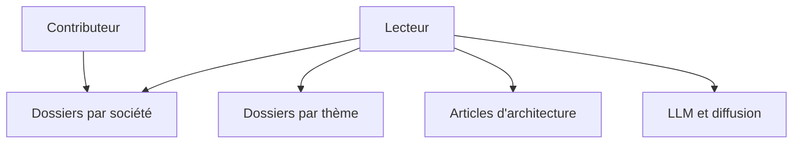

# davideuler/architecture.of.internet-product

> Library of architecture documents from large internet companies, sorted by company and by theme.

## The problem
The architectures of large internet companies are scattered across presentations and articles that are hard to find.

## What it actually does
Numbered folders per company (Weibo, Baidu, NetEase…) and lettered folders per theme (storage, high availability, message queues, ML), plus lists of articles and open source projects from Chinese companies. No code. Very short README, in Chinese.

## How it is wired

## Trying it
No command: browse the folders.

## Cost and gotchas
Free, but no license: rights on the hosted documents unknown. Last push in February 2024. The content of the documents is not verified.

## What it is not
Not software nor a written guide: a collection of external references, aging.

## Alternatives
No alternative named in the README.

## For you
Ignore: dated collection, with no license or recent update; to be consulted only as occasional reading.
