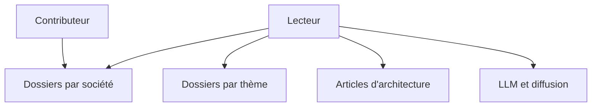

# davideuler/architecture.of.internet-product

> Bibliothèque de documents d'architecture de grandes sociétés internet, classés par entreprise et par thème.

## Le problème
Les architectures des grandes sociétés internet sont dispersées en présentations et articles difficiles à retrouver.

## Ce que ça fait vraiment
Dossiers numérotés par société (Weibo, Baidu, NetEase…) et dossiers lettrés par thème (stockage, haute disponibilité, files de messages, ML), plus des listes d'articles et de projets open source d'entreprises chinoises. Aucun code. README très court, en chinois.

## Comment c'est branché

## Essayer
Aucune commande : parcourir les dossiers.

## Coût et pièges
Gratuit, mais aucune licence : droits sur les documents hébergés inconnus. Dernier push en février 2024. Le contenu des documents n'est pas vérifié.

## Ce que ce n'est pas
Pas un logiciel ni un guide rédigé : une collection de références externes, vieillissante.

## Alternatives
Aucune alternative nommée dans le README.

## Pour toi
Ignorer : collection datée, sans licence ni mise à jour récente ; à ne consulter qu'en lecture occasionnelle.

