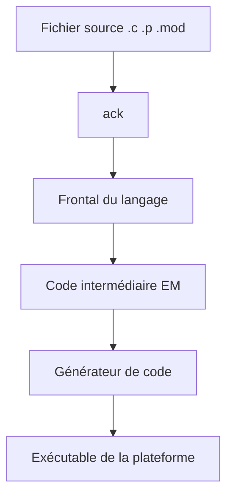

# davidgiven/ack

> Amsterdam Compiler Kit toolchain: C, Pascal, Modula 2 and Basic compilers targeting many legacy platforms.

## The problem
Compiling old code for retro platforms (CP/M, MS-DOS, Minix, PDP-11) without a suitable modern toolchain.

## What it actually does
Provides front ends for ANSI C, Pascal, Modula 2 and Basic, code generators and libraries. The `ack` command drives the compiler and linker, with a `-m` platform option. The README warns that the libraries are limited and that not everything can be compiled.

## How it is wired
Simplified diagram based on the sheet, no diagram provided.



## Trying it
```bash
make
sudo make install
ack -mlinux386 -O examples/paranoia.c
```

## Cost and gotchas
Free. Requires gcc, flex, yacc, GNU make, Lua with lua-posix, Python 3.4+ and about 1 GB. The object format is specific to ACK. The license is described as "BSD-like" but not identified by GitHub.

## What it is not
Not an optimized modern compiler: the README describes an environment very different from today's.

## Alternatives
No alternative named in the README.

## For you
Ignore: historical or retro-computing interest, unrelated to data, AI or MLOps work.
