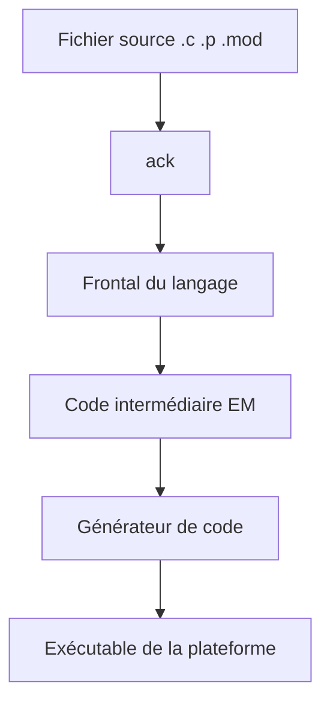

# davidgiven/ack

> Chaîne de compilation Amsterdam Compiler Kit : compilateurs C, Pascal, Modula 2 et Basic vers de nombreuses cibles anciennes.

## Le problème
Compiler du code ancien vers des plateformes rétro (CP/M, MS-DOS, Minix, PDP-11) sans chaîne moderne adaptée.

## Ce que ça fait vraiment
Fournit des frontaux pour ANSI C, Pascal, Modula 2 et Basic, des générateurs de code et des bibliothèques. La commande `ack` pilote compilateur et éditeur de liens, avec une option de plateforme `-m`. Le README avertit que les bibliothèques sont limitées et que tout n'est pas compilable.

## Comment c'est branché
Schéma simplifié d'après la fiche, sans diagramme fourni.



## Essayer
```bash
make
sudo make install
ack -mlinux386 -O examples/paranoia.c
```

## Coût et pièges
Gratuit. Il faut gcc, flex, yacc, GNU make, Lua avec lua-posix, Python 3.4+ et environ 1 Go. Le format objet est propre à ACK. La licence est décrite comme « BSD-like » mais non identifiée par GitHub.

## Ce que ce n'est pas
Pas un compilateur moderne optimisé : le README parle d'un environnement très différent de celui d'aujourd'hui.

## Alternatives
Aucune alternative nommée dans le README.

## Pour toi
À ignorer : intérêt historique ou rétro-informatique, sans rapport avec un travail data, IA ou MLOps.

