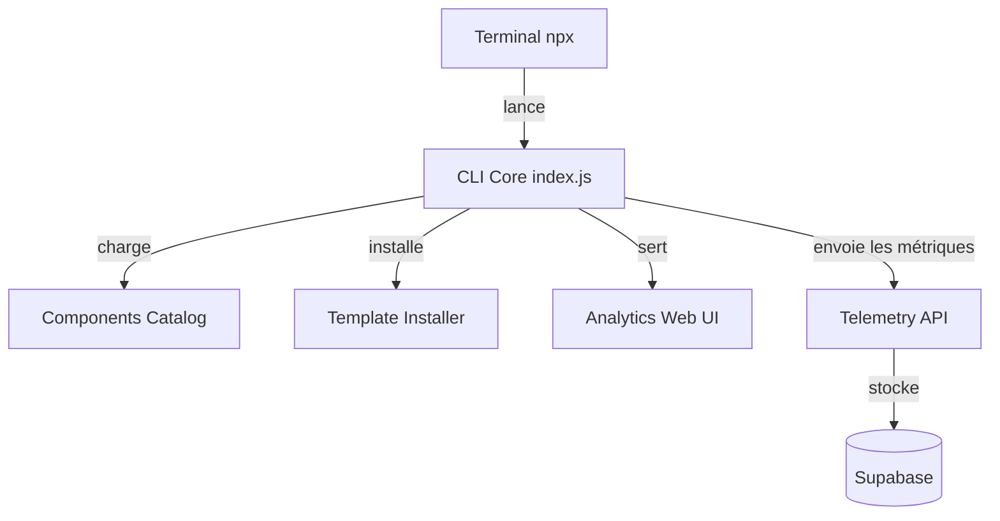

# davila7/claude-code-templates

> CLI that installs ready-to-use skills, agents, commands and hooks for Claude Code in a single command.

## The problem
Configuring Claude Code (agents, commands, MCP, hooks) by hand is slow, and the good configurations are scattered.

## What it actually does
A catalog of about 1,900 components: skills, agents, commands, MCP, settings, hooks, mods, autonomous loops, sandboxes and project templates. The CLI writes the chosen files into the project. It also ships a local analytics dashboard (port 3333), a conversation browser (port 9876) and a health check. Some components come from other repositories, with their original license.

## How it is wired


## Trying it
```bash
npx claude-code-templates@latest
npx claude-code-templates@latest --skill creative-design/frontend-design --yes
npx claude-code-templates@latest --agent development-tools/code-reviewer --yes
npx claude-code-templates@latest --health-check
```

## Cost and gotchas
Free. The architecture describes download tracking sent to Supabase: review it before using it in a company. The installed components act on your project; you need to read them. Several options were removed in 1.31.0.

## What it is not
It is not an Anthropic product. It is not a quality guarantee: the catalog aggregates third-party contributions.

## Alternatives
obra/superpowers, wshobson/agents and anthropics/skills: sources from which some components are taken.

## For you
Worth watching to get started quickly with Claude Code; be selective about what you install, because a single maintainer runs a very broad catalog.
