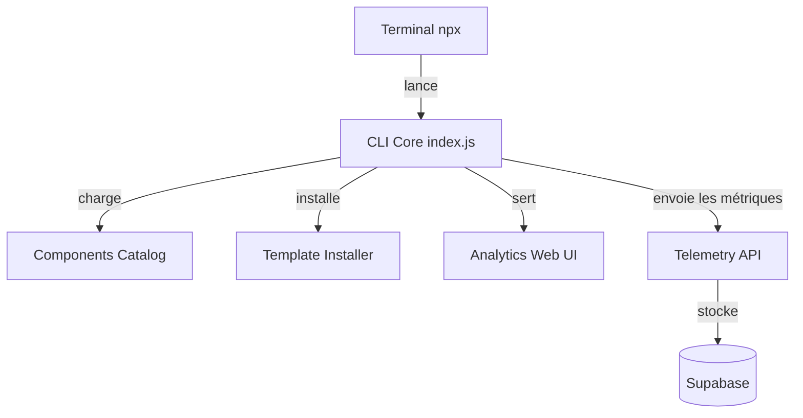

# davila7/claude-code-templates

> CLI qui installe en une commande des skills, agents, commandes et hooks prêts à l'emploi pour Claude Code.

## Le problème
Configurer Claude Code (agents, commandes, MCP, hooks) à la main est long, et les bonnes configurations sont dispersées.

## Ce que ça fait vraiment
Un catalogue d'environ 1 900 composants : skills, agents, commandes, MCP, réglages, hooks, mods, boucles autonomes, bacs à sable et gabarits de projet. La CLI écrit les fichiers choisis dans le projet. Elle embarque aussi un tableau de bord d'analyse en local (port 3333), un navigateur de conversations (port 9876) et un contrôle de santé. Certains composants viennent d'autres dépôts, avec leur licence d'origine.

## Comment c'est branché


## Essayer
```bash
npx claude-code-templates@latest
npx claude-code-templates@latest --skill creative-design/frontend-design --yes
npx claude-code-templates@latest --agent development-tools/code-reviewer --yes
npx claude-code-templates@latest --health-check
```

## Coût et pièges
Gratuit. L'architecture décrit un suivi des téléchargements vers Supabase : relire avant usage en entreprise. Les composants installés agissent sur ton projet ; il faut les relire. Plusieurs options ont été supprimées en 1.31.0.

## Ce que ce n'est pas
Ce n'est pas un produit d'Anthropic. Ce n'est pas une garantie de qualité : le catalogue agrège des contributions de tiers.

## Alternatives
obra/superpowers, wshobson/agents et anthropics/skills : sources dont certains composants sont repris.

## Pour toi
À surveiller pour démarrer vite avec Claude Code ; trie ce que tu installes, car un seul mainteneur gère un catalogue très large.

