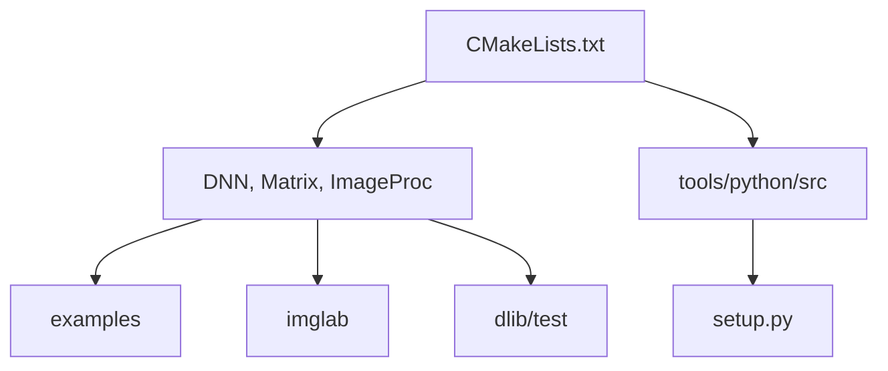

# davisking/dlib

> C++ machine learning and vision toolkit, with a Python API, for use including commercial.

## The problem
You need ML, linear algebra and vision algorithms usable in C++ without heavy dependencies.

## What it actually does
Header-based C++17 library, organized into modules: neural networks (dnn), image processing, matrices, statistics, optimization, SVM, GUI, threads, I/O. A Python API via pybind11 installs with pip. Tools are provided (imglab, htmlify, network conversion to Caffe), plus examples and tests. CUDA and BLAS are optional according to the described architecture.

## How it is wired


## Trying it
```bash
pip install dlib
mkdir build; cd build; cmake .. ; cmake --build .
vcpkg install dlib
cd dlib/test && mkdir build && cd build && cmake .. && cmake --build . --config Release && ./dtest --runall
```

## Cost and gotchas
Free. Building the Python package requires a C++17 compiler and CMake; the AVX options speed up some computations.

## What it is not
Not a general-purpose deep learning framework like the big Python tools: it is mainly a C++ toolkit. No information on governance in the README beyond the owner.

## Alternatives
No alternative named in the README.

## For you
Worth adopting if you need face detection or C++ ML tools; the BSL license allows closed commercial use.
