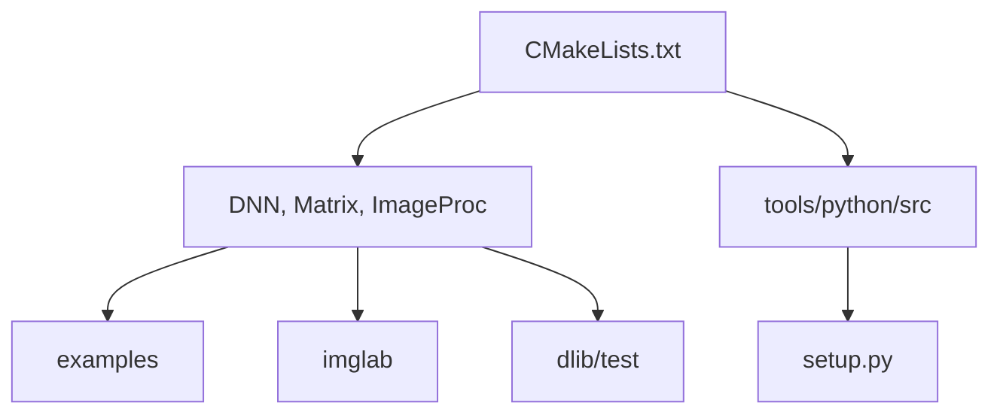

# davisking/dlib

> Boîte à outils C++ de machine learning et de vision, avec une API Python, pour usage même commercial.

## Le problème
Il faut des algorithmes de ML, d'algèbre linéaire et de vision utilisables en C++ sans dépendances lourdes.

## Ce que ça fait vraiment
Bibliothèque C++17 à en-têtes, organisée en modules : réseaux de neurones (dnn), traitement d'image, matrices, statistiques, optimisation, SVM, GUI, threads, E/S. Une API Python via pybind11 s'installe avec pip. Des outils sont fournis (imglab, htmlify, conversion de réseaux vers Caffe), plus exemples et tests. CUDA et BLAS sont optionnels d'après l'architecture décrite.

## Comment c'est branché


## Essayer
```bash
pip install dlib
mkdir build; cd build; cmake .. ; cmake --build .
vcpkg install dlib
cd dlib/test && mkdir build && cd build && cmake .. && cmake --build . --config Release && ./dtest --runall
```

## Coût et pièges
Gratuit. La compilation Python exige un compilateur C++17 et CMake ; les options AVX accélèrent certains calculs.

## Ce que ce n'est pas
Pas un framework de deep learning généraliste comme les grands outils Python : c'est surtout une boîte à outils C++. Aucune information sur la gouvernance dans le README au-delà du propriétaire.

## Alternatives
Aucune alternative nommée dans le README.

## Pour toi
À adopter si tu as besoin de détection de visages ou d'outils C++ de ML ; la licence BSL permet l'usage fermé commercial.

