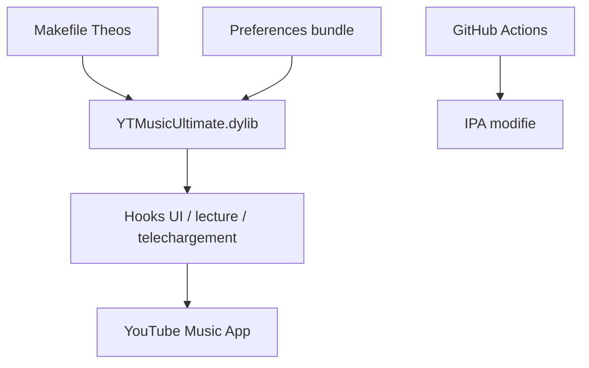

# dayanch96/YTMusicUltimate

> iOS tweak (jailbreak or sideloading) that modifies the YouTube Music app.

## The problem
Extending the YouTube Music iOS app (background playback, downloads) is not officially possible.

## What it actually does
A library injected into the app (Theos/Logos) with playback, interface and download hooks (SponsorBlock, premium status, background playback, embedded FFmpeg) and a preferences bundle. Distributed as a .deb (jailbreak) or built into an IPA that you build yourself.

## How it is wired


## Trying it
```bash
make clean package
make clean package ROOTLESS=1
make clean package SIDELOADING=1
```

## Cost and gotchas
Free. You need a decrypted IPA supplied by you, and Theos. Using it works around restrictions of a third-party app (terms of use, rights).

## What it is not
Not a ready-to-use IPA: the README states it is no longer provided.

## Alternatives
No alternative named in the README.

## For you
Ignore: modifying a consumer app on iOS, outside the data/AI/MLOps scope.
