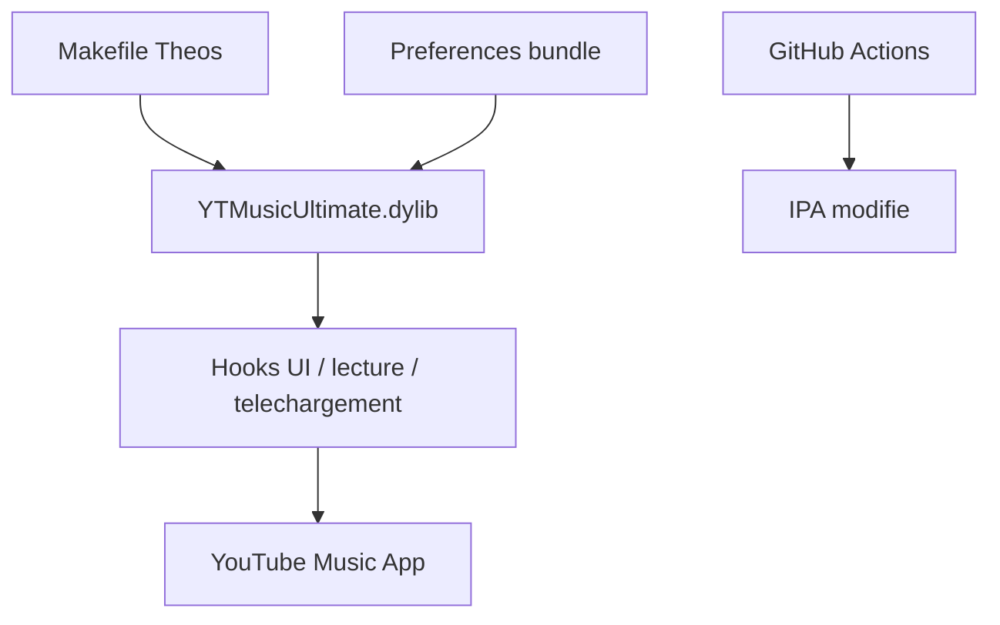

# dayanch96/YTMusicUltimate

> Tweak iOS (jailbreak ou sideloading) qui modifie l'application YouTube Music.

## Le problème
Étendre l'application YouTube Music iOS (lecture en arrière-plan, téléchargements) n'est pas possible officiellement.

## Ce que ça fait vraiment
Bibliothèque injectée dans l'app (Theos/Logos) avec crochets de lecture, d'interface et de téléchargement (SponsorBlock, statut premium, lecture en arrière-plan, FFmpeg embarqué) et un bundle de préférences. Distribué en .deb (jailbreak) ou intégré à un IPA que tu construis toi-même.

## Comment c'est branché


## Essayer
```bash
make clean package
make clean package ROOTLESS=1
make clean package SIDELOADING=1
```

## Coût et pièges
Gratuit. Il faut un IPA déchiffré fourni par toi, et Theos. L'usage contourne des restrictions d'une app tierce (conditions d'usage, droits).

## Ce que ce n'est pas
Pas un IPA prêt à l'emploi : le README indique qu'il n'est plus fourni.

## Alternatives
Aucune alternative nommée dans le README.

## Pour toi
À ignorer : modification d'app grand public sur iOS, hors périmètre data/IA/MLOps.

