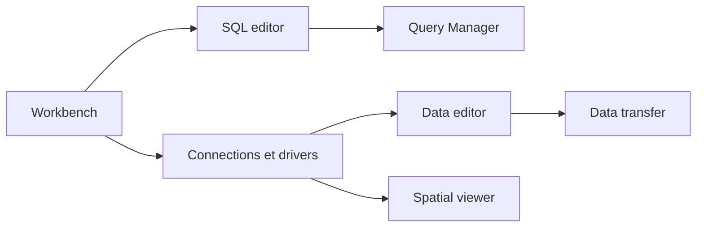

# dbeaver/dbeaver

> A versatile database client for developers, DBAs, and analysts, with over 100 drivers.

## The problem
Each database has its own client; switching from PostgreSQL to MySQL or SQLite requires changing the tool.

## What it actually does
Schema creation, SQL editor, data editor, ER diagrams, import/export/migration, execution plans, SSH tunnels and proxies, spatial data viewer. Compatible with any database with JDBC or ODBC drivers. An AI chatbot (OpenAI, Copilot in community edition) sends the structural context to the model. Written in Java on Eclipse RCP and OSGi.

## How it is wired

## Trying it
Install and run, or extract the archive and run `dbeaver`. There are no further instructions in the README.

## Cost and gotchas
Free community edition; NoSQL (MongoDB, Redis, etc.), file-based databases (Parquet, CSV, etc.) and native AI providers are reserved for paid PRO versions. Java included (OpenJDK 25).

## What it is not
This is not a production database or ETL tool. Many useful features for a data engineer are already available in existing tools.

## Alternatives
CloudBeaver (web version, same platform); dbvr (CLI for CI/CD).

## For you
Recommended: A universal SQL client for exploring databases, with a limit on the use of NoSQL/Parquet functions (which may incur charges).
