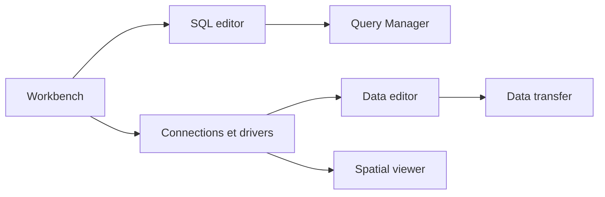

# dbeaver/dbeaver

> Client de base de données multiplateforme pour développeurs, DBA et analystes, avec plus de 100 pilotes.

## Le problème
Chaque base a son client ; passer de PostgreSQL à MySQL ou SQLite oblige à changer d'outil.

## Ce que ça fait vraiment
Édition de schémas, éditeur SQL, éditeur de données, diagrammes ER, import/export/migration, plans d'exécution, tunnels SSH et proxy, visionneuse de données spatiales. Toute base avec pilote JDBC ou ODBC. Un chat IA (OpenAI, Copilot en édition communautaire) envoie le contexte de structure au modèle. Écrit en Java sur Eclipse RCP et OSGi.

## Comment c'est branché

## Essayer
Installer puis lancer, ou décompresser l'archive et exécuter `dbeaver`. Aucune commande plus précise dans le README.

## Coût et pièges
Édition communautaire gratuite ; NoSQL (MongoDB, Redis…), fichiers comme bases (Parquet, CSV…) et fournisseurs IA natifs sont réservés aux versions PRO payantes. Java inclus (OpenJDK 25).

## Ce que ce n'est pas
Pas une base de données ni un outil d'ETL en production. Beaucoup de fonctions utiles à un data engineer sont en PRO.

## Alternatives
CloudBeaver (version web, même plateforme) ; dbvr (CLI pour CI/CD).

## Pour toi
À adopter : client SQL universel pour explorer des bases, avec la limite des fonctions NoSQL/Parquet payantes.

