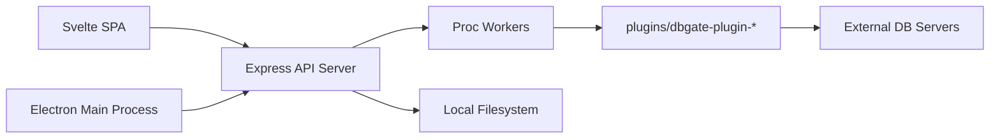

# dbgate/dbgate

> Cross-platform SQL and NoSQL database client: desktop, web or Docker.

## The problem
Working across several databases (Postgres, MongoDB, Redis…) means juggling multiple clients.

## What it actually does
Data browsing and editing, Excel-style filters, schema editing, structure comparison, ER diagram.
SQL editor with completion, visual query designer, Mongo script editor, Redis tree view.
Import and export of CSV, Excel, JSON, NDJSON, XML; charts; AI chat on the database.
Plugin architecture; Svelte front end, Express API, Electron application.

## How it is wired


## Trying it
```bash
yarn
yarn start
```

## Cost and gotchas
Free (GPL-3.0); a paid Premium license exists. 461 open issues.

## What it is not
Not a versioned schema migration tool or an ORM.

## Alternatives
No alternative named in the README.

## For you
Worth watching as a single database client to explore Postgres, Mongo and Redis; NDJSON export and Node scripts are a plus for data work.
