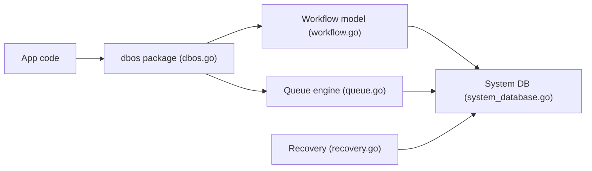

# dbos-inc/dbos-transact-golang

> Go library that makes workflows durable by recording their state in Postgres, for backend developers.

## The problem
A pipeline or payment interrupted by a crash starts over from scratch unless you add heavy recovery logic or an external orchestrator.

## What it actually does
Ordinary Go functions are registered as workflows and steps; each step is checkpointed in Postgres and the workflow resumes at the last completed step. The same database carries durable queues, exactly-once notifications, cron schedules and durable sleeps. No separate broker or orchestration server.

## How it is wired

## Trying it
No installation command in the README, which points to the quickstart. The Go example reads `DBOS_SYSTEM_DATABASE_URL` and imports `github.com/dbos-inc/dbos-transact-golang/dbos`.

## Cost and gotchas
A Postgres database is required. Workflows must be written to be deterministic and resumable; throughput is bounded by what Postgres can support.

## What it is not
Not a data orchestrator with ready-made connectors; not a very-high-throughput broker. Go only here.

## Alternatives
- Temporal: preferable if you do not want Postgres or need another language.
- Airflow: for its connector ecosystem.
- Celery / BullMQ: for very high throughput without durability.

## For you
Worth watching: interesting for pipelines or agents that must resume after failure, but reserved for a Go stack; the Python equivalent is not here.
