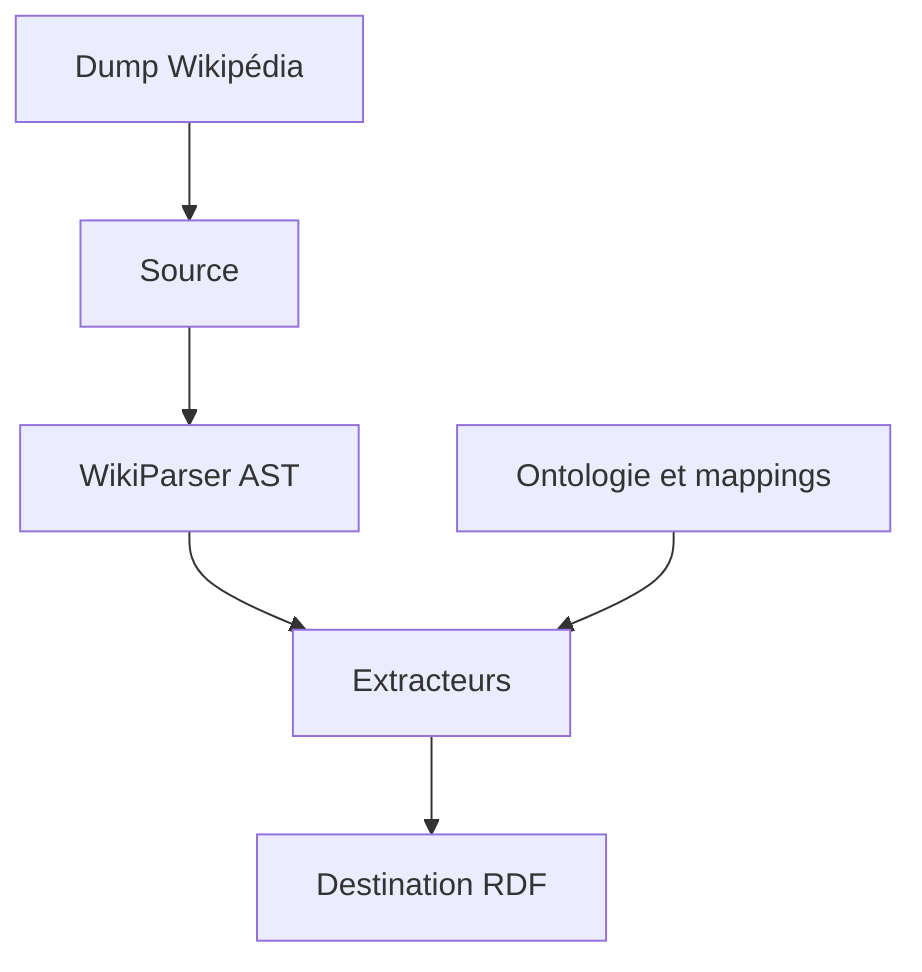

# dbpedia/extraction-framework

> Scala framework that extracts structured data from Wikipedia as an RDF graph for DBpedia.

## The problem
Wikipedia contains useful information, but locked in wiki text, hard to query.

## What it actually does
A parser turns MediaWiki pages into a syntax tree, extractors pull RDF statements from it, and a destination writes them out. Modules: core (source, parser, extractor, destination, ontology) and dump extraction. A full run through the MARVIN bot takes four to seven days; more than half of the extractors also run on Apache Spark.

## How it is wired

Simplified diagram based on the sheet, no diagram provided.

## Trying it
```bash
git clone https://git.informatik.uni-leipzig.de/dbpedia-assoc/marvin-config
cd marvin-config
./setup-or-reset-dief.sh
./marvin_extraction_run.sh test
```

## Cost and gotchas
Free, but heavy: days of computation, large Wikipedia dumps, Spark to speed things up. The catalog declares no license while the README mentions the GPL; to be checked. The README cites Scala 2.8, so it looks dated.

## What it is not
Not a ready-to-use SPARQL endpoint: it produces the data that DBpedia publishes.

## Alternatives
No alternative named in the README.

## For you
Watch: a source of knowledge graphs for RAG or enrichment, but it is better to consume the published DBpedia datasets than to rerun the extraction.
