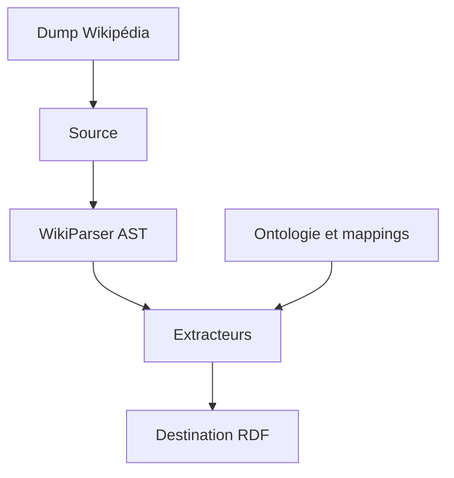

# dbpedia/extraction-framework

> Cadriciel Scala qui extrait des données structurées de Wikipédia sous forme de graphe RDF pour DBpedia.

## Le problème
Wikipédia contient des informations utiles, mais enfermées dans du texte wiki, difficiles à interroger.

## Ce que ça fait vraiment
Un analyseur transforme les pages MediaWiki en arbre syntaxique, des extracteurs en tirent des déclarations RDF, et une destination les écrit. Modules : cœur (source, analyseur, extracteur, destination, ontologie) et extraction de dumps. Une exécution complète via le robot MARVIN dure quatre à sept jours ; plus de la moitié des extracteurs tournent aussi sur Apache Spark.

## Comment c'est branché

Schéma simplifié d'après la fiche, sans diagramme fourni.

## Essayer
```bash
git clone https://git.informatik.uni-leipzig.de/dbpedia-assoc/marvin-config
cd marvin-config
./setup-or-reset-dief.sh
./marvin_extraction_run.sh test
```

## Coût et pièges
Gratuit, mais lourd : jours de calcul, dumps Wikipédia volumineux, Spark pour accélérer. Le catalogue ne déclare aucune licence alors que le README évoque la GPL ; à vérifier. Le README cite Scala 2.8, donc il paraît daté.

## Ce que ce n'est pas
Pas un point d'accès SPARQL prêt à l'emploi : il produit les données que DBpedia publie.

## Alternatives
Aucune alternative nommée dans le README.

## Pour toi
Surveiller : source de graphes de connaissances pour du RAG ou de l'enrichissement, mais mieux vaut consommer les jeux DBpedia publiés que relancer l'extraction.

