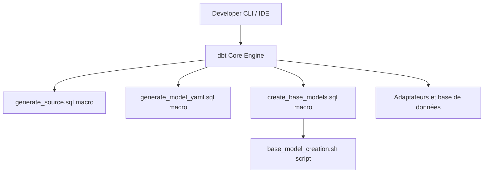

# dbt-labs/dbt-codegen

> dbt macros that generate starter YAML and SQL for sources, models and tests.

## The problem
Declaring dozens of sources, base models and schema.yml files by hand in dbt is slow and repetitive.

## What it actually does
Macros that print to the console: `generate_source`, `generate_base_model`, `generate_model_yaml`, `generate_model_import_ctes`, `generate_unit_test_template`. `create_base_models` writes files through a bash script. The output has to be copied and tweaked.

## How it is wired


## Trying it
```bash
dbt deps
dbt run-operation generate_source --args 'schema_name: raw_jaffle_shop'
dbt run-operation generate_model_yaml --args '{"model_names": ["customers"]}'
```
Beforehand, add `dbt-labs/codegen` to `packages.yml`.

## Cost and gotchas
A dbt project and a warehouse connection are required. `create_base_models` does not work in the dbt Cloud IDE.

## What it is not
Not a generator that modifies the project by itself: the output is displayed, then pasted by hand. Not a transformation tool.

## Alternatives
None cited in the README.

## For you
Adopt: if you use dbt, it is an immediate time saver, published by dbt Labs and free of charge.
