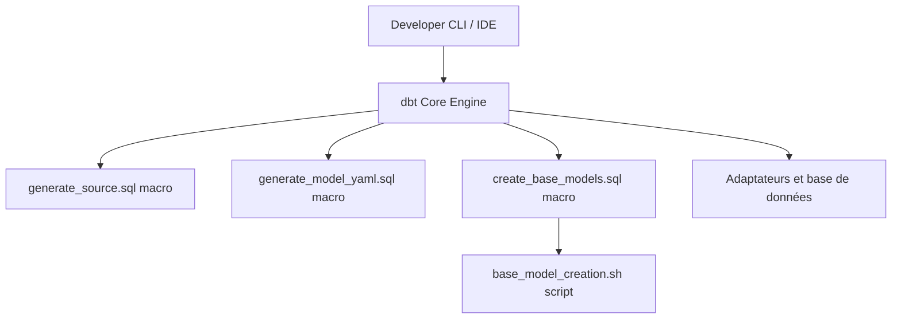

# dbt-labs/dbt-codegen

> Macros dbt qui génèrent du YAML et du SQL de départ pour sources, modèles et tests.

## Le problème
Déclarer à la main des dizaines de sources, modèles de base et fichiers schema.yml dans dbt est long et répétitif.

## Ce que ça fait vraiment
Macros qui affichent dans la console : `generate_source`, `generate_base_model`, `generate_model_yaml`, `generate_model_import_ctes`, `generate_unit_test_template`. `create_base_models` écrit des fichiers via un script bash. Le résultat est à copier et à retoucher.

## Comment c'est branché


## Essayer
```bash
dbt deps
dbt run-operation generate_source --args 'schema_name: raw_jaffle_shop'
dbt run-operation generate_model_yaml --args '{"model_names": ["customers"]}'
```
Avant, ajouter `dbt-labs/codegen` dans `packages.yml`.

## Coût et pièges
Un projet dbt et une connexion à un entrepôt sont indispensables. `create_base_models` ne fonctionne pas dans le dbt Cloud IDE.

## Ce que ce n'est pas
Pas un générateur qui modifie le projet tout seul : la sortie est affichée, puis collée à la main. Pas un outil de transformation.

## Alternatives
Aucune citée dans le README.

## Pour toi
Adopter : si tu utilises dbt, c'est un gain de temps immédiat, édité par dbt Labs et sans coût.

