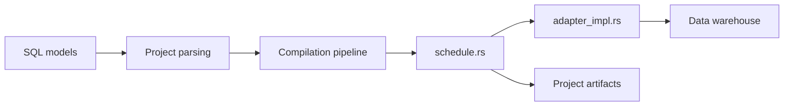

# dbt-labs/dbt-core

> Transforms warehouse data through versioned, tested SELECT queries; the main branch is the Rust v2.

## The problem
SQL transformations without versioning, tests or a dependency graph become unmanageable.

## What it actually does
SQL models are parsed, compiled, scheduled and executed in the warehouse, with tests and lineage. v2 is a Rust rewrite: single binary, faster, strict specification, Parquet artifacts in addition to JSON, revamped local documentation. The Python v1 lives on `1.latest`.

## How it is wired


## Trying it
```bash
# Aucune commande documentée dans ce README :
# renvoie vers la page d'installation de dbt.
```

## Cost and gotchas
Free on the Apache-2.0 code side. The dbt distribution is under the dbt product license. A warehouse is required. Mind the branch: v1 is on `1.latest`.

## What it is not
Not an extract or load tool: it transforms what is already in the warehouse. v2 is announced as a complete rewrite.

## Alternatives
Not documented: the README names no alternative.

## For you
Adopt for any analytics pipeline: the standard for SQL transformation; check whether you are targeting v1 or v2.
