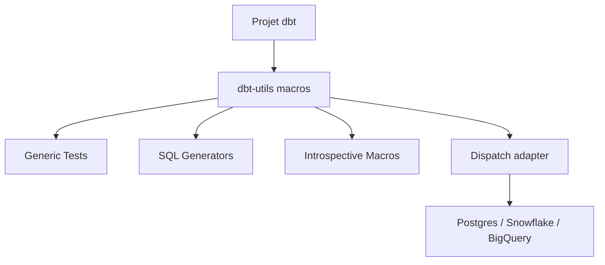

# dbt-labs/dbt-utils

> A dbt package of reusable macros: generic tests, SQL generators and Jinja helpers, for analytics engineers.

## The problem
Every dbt project rewrites the same tests (composite uniqueness, ranges, freshness) and the same repetitive SQL (pivot, deduplication, date spine).

## What it actually does
Adds generic tests (`equal_rowcount`, `expression_is_true`, `recency`, `unique_combination_of_columns`, `accepted_range`…), introspective macros (`get_column_values`, `get_relations_by_pattern`), SQL generators (`date_spine`, `deduplicate`, `pivot`, `unpivot`, `star`, `union_relations`, `generate_surrogate_key`), web macros and Jinja helpers. Adapter dispatch lets you override a macro. Tests now accept `arguments:` (dbt Core ≥ 1.10.6, mandatory with Fusion).

## How it is wired


## Trying it
```bash
# Installation : voir dbt Hub (aucune commande dans le README).
```
```sql
{{ dbt_utils.generate_surrogate_key(['field_a', 'field_b']) }}
{{ dbt_utils.date_spine(datepart="day", start_date="cast('2019-01-01' as date)", end_date="cast('2020-01-01' as date)") }}
```

## Cost and gotchas
Free, but requires a dbt project and a warehouse. The syntax of test arguments changes depending on the dbt Core version.

## What it is not
Not a standalone tool. `insert_by_period` has left the package (experimental repo) and the cross-database macros have moved into dbt Core since 1.0.

## Alternatives
No alternative named in the README (the experimental repo of `insert_by_period` is cited there).

## For you
Worth adopting if you do dbt: it is the standard macro foundation, Apache-2.0, maintained by dbt Labs.
