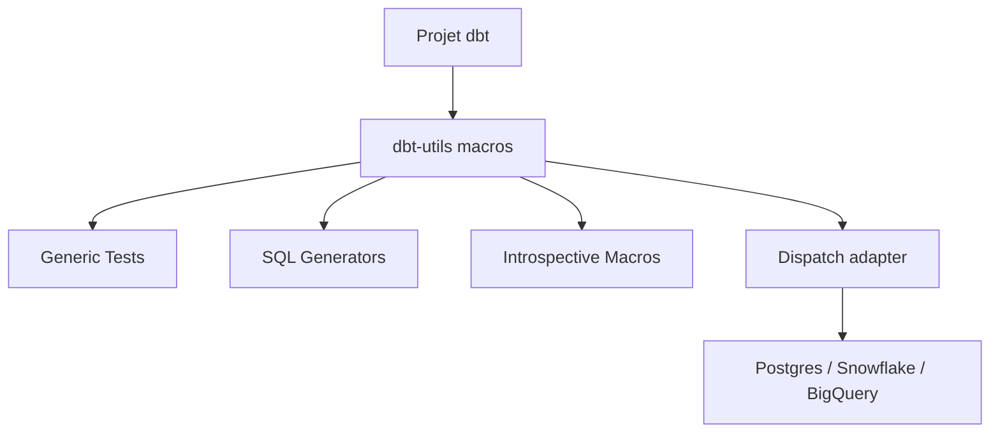

# dbt-labs/dbt-utils

> Package dbt de macros réutilisables : tests génériques, générateurs SQL et helpers Jinja, pour analytics engineers.

## Le problème
Chaque projet dbt réécrit les mêmes tests (unicité composite, plages, fraîcheur) et le même SQL répétitif (pivot, déduplication, spine de dates).

## Ce que ça fait vraiment
Ajoute des tests génériques (`equal_rowcount`, `expression_is_true`, `recency`, `unique_combination_of_columns`, `accepted_range`…), des macros introspectives (`get_column_values`, `get_relations_by_pattern`), des générateurs SQL (`date_spine`, `deduplicate`, `pivot`, `unpivot`, `star`, `union_relations`, `generate_surrogate_key`), des macros web et des helpers Jinja. Le dispatch par adapter permet de surcharger une macro. Les tests acceptent désormais `arguments:` (dbt Core ≥ 1.10.6, obligatoire avec Fusion).

## Comment c'est branché


## Essayer
```bash
# Installation : voir dbt Hub (aucune commande dans le README).
```
```sql
{{ dbt_utils.generate_surrogate_key(['field_a', 'field_b']) }}
{{ dbt_utils.date_spine(datepart="day", start_date="cast('2019-01-01' as date)", end_date="cast('2020-01-01' as date)") }}
```

## Coût et pièges
Gratuit, mais demande un projet dbt et un entrepôt. La syntaxe des arguments de test change selon la version de dbt Core.

## Ce que ce n'est pas
Pas un outil autonome. `insert_by_period` a quitté le package (dépôt expérimental) et les macros cross-database sont passées dans dbt Core depuis la 1.0.

## Alternatives
Aucune alternative nommée dans le README (le dépôt expérimental d'`insert_by_period` y est cité).

## Pour toi
À adopter si tu fais du dbt : c'est le socle de macros standard, Apache-2.0, maintenu par dbt Labs.

