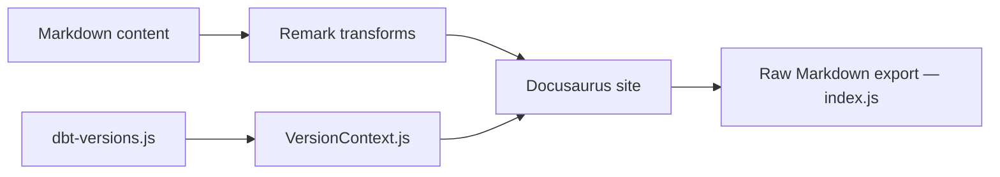

# dbt-labs/docs.getdbt.com

> Docusaurus source of dbt's official documentation, to contribute or run it locally.

## The problem
Fixing or enriching dbt's documentation requires knowing where it lives and how to preview it.

## What it actually does
The repository contains the Docusaurus site in Markdown (sometimes HTML) with multiple dbt versions, content shared between pages, tabs, getting-started guides, a blog and page feedback. Plugins convert the content to raw Markdown for LLMs. Four Claude Code skills automate issue triage, page creation and availability badges.

## How it is wired


## Trying it
```bash
git clone https://github.com/dbt-labs/docs.getdbt.com.git
cd docs.getdbt.com
cd website
npm install
npm start
npm run build
```

## Cost and gotchas
Free. On Mac, `npm install` may require `brew install vips`, which is slow. Every PR goes through editorial and technical review. 228 open issues.

## What it is not
Not dbt's own code nor a tool to use: it is the content of a documentation site.

## Alternatives
No alternative named in the README.

## For you
Keep an eye on it: useful if you want to fix the dbt docs or copy the repository's Claude Code skills, with no other direct value.
