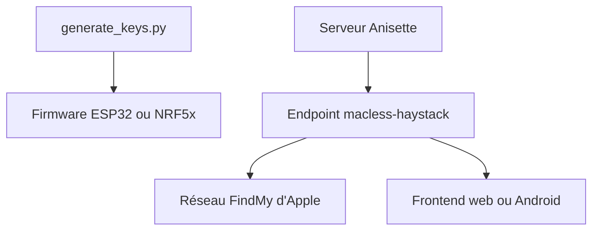

# dchristl/macless-haystack

> A custom FindMy network, without a Mac, to track self-built ESP32 or nRF5x beacons.

## The problem
Using Apple's location network with your own beacons required a Mac and OpenHaystack's Mail plug-in.

## What it actually does
It combines OpenHaystack, Biemster's FindMy and FindYou. A script generates the keys, an ESP32 or nRF5x firmware is flashed on the beacon, and a Docker server (Anisette then the macless-haystack endpoint) queries Apple's location reports with your Apple ID. An Android app or a web page displays the positions.

## How it is wired


## Trying it
```bash
docker network create mh-network
docker run -d --restart always --name anisette -p 6969:6969 --volume anisette-v3_data:/home/Alcoholic/.config/anisette-v3 --network mh-network dadoum/anisette-v3-server
docker run -it --restart unless-stopped --name macless-haystack -p 6176:6176 --volume mh_data:/app/endpoint/data --network mh-network christld/macless-haystack
docker restart macless-haystack
```

## Cost and gotchas
You need an Apple ID with SMS two-factor authentication and must enter its password in the container. Beacon hardware to flash yourself.

## What it is not
Not a consumer product: the README says it is for research and education, at your own risk. It depends on Apple's network and may stop working.

## Alternatives
- OpenHaystack: the original project, which requires a Mac.

## For you
Ignore: a hardware tinkering project tied to Apple's network and your Apple ID, outside your data, AI or MLOps scope.
