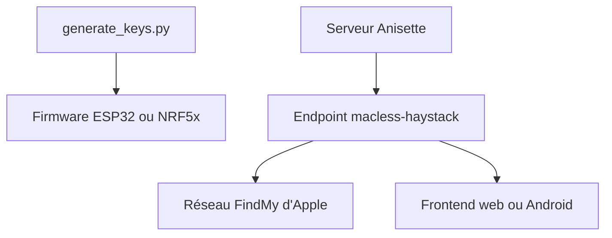

# dchristl/macless-haystack

> Un réseau FindMy personnalisé, sans Mac, pour suivre des balises ESP32 ou nRF5x construites soi-même.

## Le problème
Utiliser le réseau de localisation d'Apple avec ses propres balises demandait un Mac et le plug-in Mail d'OpenHaystack.

## Ce que ça fait vraiment
Il réunit OpenHaystack, FindMy de Biemster et FindYou. Un script génère les clés, un micrologiciel ESP32 ou nRF5x est flashé sur la balise, un serveur Docker (Anisette puis le point d'accès macless-haystack) interroge les rapports de localisation d'Apple avec ton identifiant Apple. Une application Android ou une page web affiche les positions.

## Comment c'est branché


## Essayer
```bash
docker network create mh-network
docker run -d --restart always --name anisette -p 6969:6969 --volume anisette-v3_data:/home/Alcoholic/.config/anisette-v3 --network mh-network dadoum/anisette-v3-server
docker run -it --restart unless-stopped --name macless-haystack -p 6176:6176 --volume mh_data:/app/endpoint/data --network mh-network christld/macless-haystack
docker restart macless-haystack
```

## Coût et pièges
Il faut un identifiant Apple avec double authentification par SMS et en saisir le mot de passe dans le conteneur. Matériel de balise à flasher soi-même.

## Ce que ce n'est pas
Pas un produit grand public : le README le dit pour la recherche et l'éducation, à tes risques. Il dépend du réseau d'Apple et peut cesser de fonctionner.

## Alternatives
- OpenHaystack : projet d'origine, qui exige un Mac.

## Pour toi
À ignorer : projet de bricolage matériel lié au réseau d'Apple et à ton identifiant Apple, hors de ton périmètre data, IA ou MLOps.

