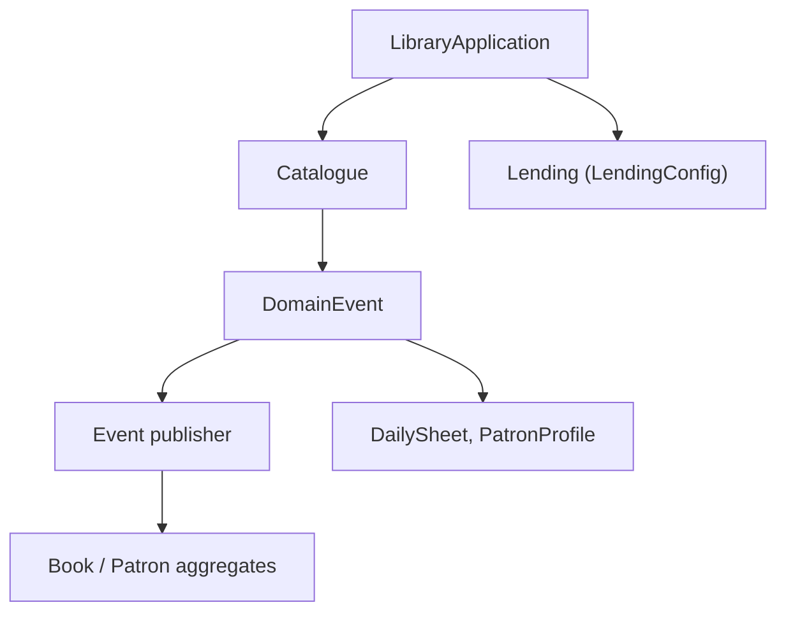

# ddd-by-examples/library

> Example project of a public library, built with DDD and hexagonal architecture, for Java developers.

## The problem
DDD examples are often too simple or theoretical, far from real business needs.

## What it actually does
A modular monolith in Java 11 / Spring Boot with two contexts, `catalogue` (CRUD) and `lending` (business logic, hexagonal). Aggregates talk to each other through domain events, with an immediate publisher or deferred storage. The read models (daily sheets, patron profile) follow the CQRS principle, without an ORM.

## How it is wired


## Trying it
```bash
# Le README fourni (tronqué) ne contient aucune commande de lancement.
# L'architecture indique un lancement via Maven ou conteneur sur le port 8080.
```

## Cost and gotchas
Free. Java 11, Maven and Docker Compose (Prometheus, Grafana), of which only Docker appears in the list. The README is mostly a long, educational text.

## What it is not
It is not a product or a reusable framework: it is an example to read. Microservices are only one possible evolution.

## Alternatives
The README names none.

## For you
Worth watching: a good read on events, CQRS and domain/infrastructure separation if you design data services, but in Java.
