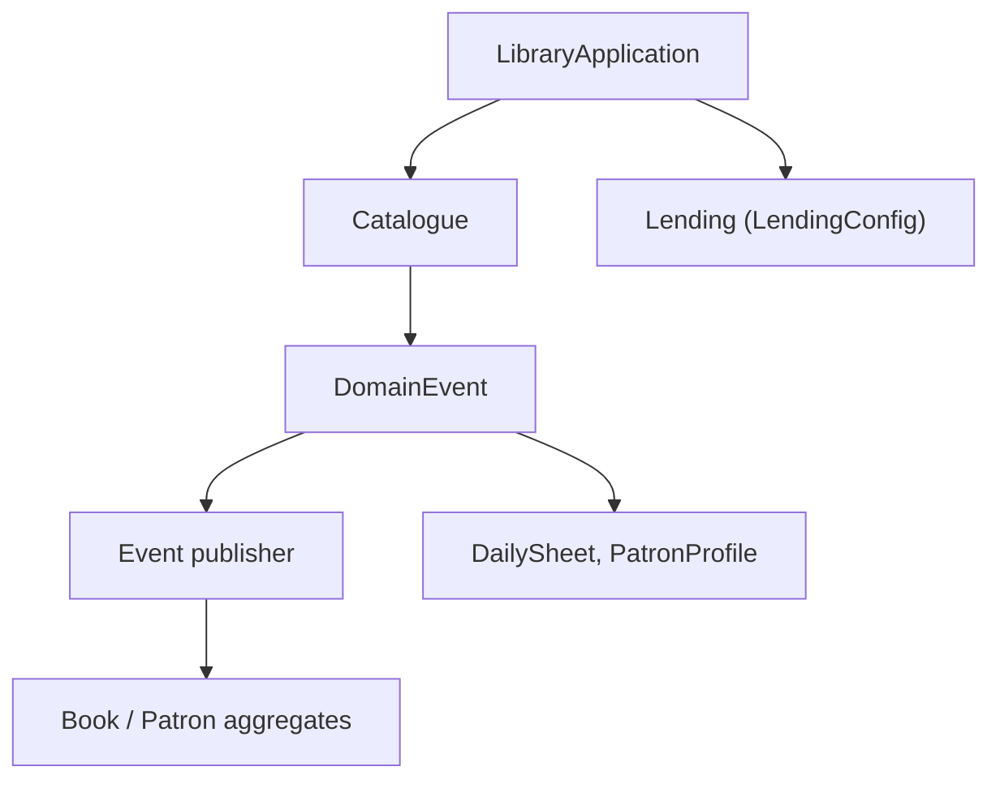

# ddd-by-examples/library

> Projet d'exemple d'une bibliothèque publique, bâti en DDD et architecture hexagonale, pour développeurs Java.

## Le problème
Les exemples de DDD sont souvent trop simples ou théoriques, loin de besoins métier réels.

## Ce que ça fait vraiment
Un monolithe modulaire Java 11 / Spring Boot avec deux contextes, `catalogue` (CRUD) et `lending` (logique métier, hexagonale). Les agrégats se parlent par événements de domaine, avec un éditeur immédiat ou en stockage différé. Les modèles de lecture (feuilles du jour, profil du lecteur) suivent le principe CQRS, sans ORM.

## Comment c'est branché


## Essayer
```bash
# Le README fourni (tronqué) ne contient aucune commande de lancement.
# L'architecture indique un lancement via Maven ou conteneur sur le port 8080.
```

## Coût et pièges
Gratuit. Java 11, Maven et Docker Compose (Prometheus, Grafana), dont seul Docker figure dans la liste. Le README est surtout un texte pédagogique, long.

## Ce que ce n'est pas
Ce n'est pas un produit ni un framework réutilisable : c'est un exemple à lire. Les microservices ne sont qu'une évolution possible.

## Alternatives
Le README n'en nomme aucune.

## Pour toi
À surveiller : bonne lecture sur les événements, CQRS et la séparation domaine/infrastructure si tu conçois des services de données, mais en Java.

