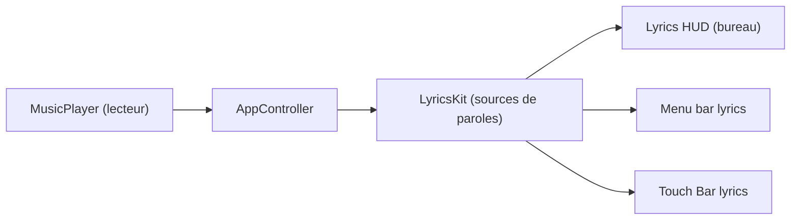

# ddddxxx/LyricsX

> macOS application that displays synchronized lyrics of the music currently playing in a player.

## The problem
Following a track's lyrics without opening a web page next to the player.

## What it actually does
Hooks into music players, searches and downloads timed lyrics from online sources, and displays them on the desktop, in the menu bar and on the Touch Bar. Adjustable offset, double-click to jump, drag-and-drop import/export, LRCX format (LRC-compatible), Traditional/Simplified Chinese conversion. iOS and Linux versions are "in early development".

## How it is wired


## Trying it
```bash
brew install --cask lyricsx
```

## Cost and gotchas
Free. macOS 10.11 minimum. Lyrics belong to their rights holders (README disclaimer).

## What it is not
Not a music player nor an LRCX editor: no official editor exists.

## Alternatives
No alternative named in the README.

## For you
Ignore: consumer macOS application with no link to data, AI or MLOps.
