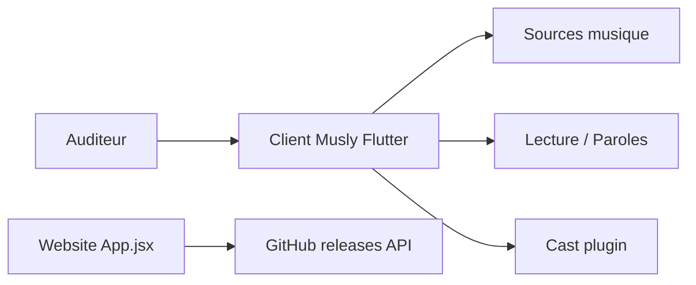

# dddevid/Musly

> Cross-platform Flutter music player for self-hosted libraries, web streams and local files.

## The problem
Listening to your Navidrome, Jellyfin or local library often requires several apps depending on the platform.

## What it actually does
A single client for Subsonic/Navidrome/Jellyfin/Emby servers, web streams, local folder and internet radio. Gapless playback, ReplayGain, synced lyrics, offline downloads, UPnP/DLNA casting, Material You themes and "Wrapped" listening statistics. The repository also contains a React showcase site and a Cast plugin. Translated into 27 languages.

## How it is wired


## Trying it
```bash
git clone https://github.com/dddevid/Musly.git
cd Musly
flutter pub get
flutter run
```
Otherwise download the executable from the Releases page.

## Cost and gotchas
Free. A license is present but not identified by GitHub: read it before reuse. An Android `ytdlp_helper.py` helper exists for web streaming; the README does not detail its use.

## What it is not
Not a music server: you must provide one for the self-hosted part. Nothing AI or data related.

## Alternatives
No alternative cited in the README.

## For you
Ignore: an audio player unrelated to data/AI/MLOps, and an unclear license.
