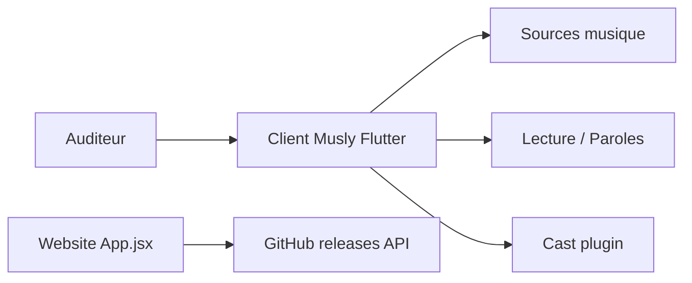

# dddevid/Musly

> Lecteur de musique Flutter multiplateforme pour bibliothèques auto-hébergées, flux web et fichiers locaux.

## Le problème
Écouter sa bibliothèque Navidrome, Jellyfin ou locale demande souvent plusieurs applications selon la plateforme.

## Ce que ça fait vraiment
Client unique pour serveurs Subsonic/Navidrome/Jellyfin/Emby, flux web, dossier local et radios internet. Lecture sans blanc, ReplayGain, paroles synchronisées, téléchargements hors ligne, diffusion UPnP/DLNA, thèmes Material You et statistiques d'écoute « Wrapped ». Le dépôt contient aussi un site vitrine React et un plugin Cast. Traduit en 27 langues.

## Comment c'est branché


## Essayer
```bash
git clone https://github.com/dddevid/Musly.git
cd Musly
flutter pub get
flutter run
```
Sinon télécharger l'exécutable depuis la page Releases.

## Coût et pièges
Gratuit. Licence présente mais non identifiée par GitHub : à lire avant réutilisation. Un helper `ytdlp_helper.py` Android existe pour le flux web ; le README n'en détaille pas l'usage.

## Ce que ce n'est pas
Pas un serveur de musique : il faut en fournir un pour la partie auto-hébergée. Rien d'IA ou de data.

## Alternatives
Aucune alternative citée dans le README.

## Pour toi
À ignorer : un lecteur audio sans rapport avec la data/IA/MLOps, et une licence floue.

