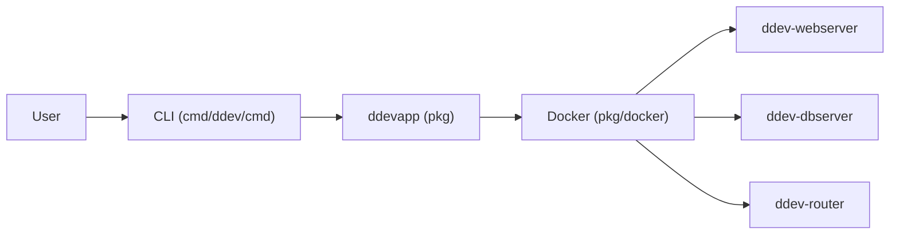

# ddev/ddev

> Local Docker-based development environments for PHP and Node.js projects, shareable across a team.

## The problem
Configuring the web server, database and PHP by hand for each project is slow, and differs from one workstation to another.

## What it actually does
`ddev start` launches the containers of a project whose configuration (PHP versions 5.6 to 8.5, Nginx or Apache, MariaDB, MySQL or PostgreSQL) is versioned with the code. According to the code, the CLI (`cmd/ddev/cmd`) relies on `pkg/ddevapp` and on four containers: `ddev-webserver`, `ddev-dbserver`, `ddev-router`, `ddev-ssh-agent`. It provides local HTTPS, Xdebug, database snapshots and hosting integrations (Upsun, Pantheon, Acquia).

## How it is wired


## Trying it
```bash
ddev start
ddev import-db
ddev snapshot
ddev exec
ddev share
ddev list
```
Installation goes through the online guide (choice of system), not reproduced in the README.

## Cost and gotchas
Free; a Docker engine is required, and macOS, Windows 11, WSL2, Linux and Codespaces are supported. `ddev share` publishes a temporary public URL of your local site: beware of real data.

## What it is not
It is not a Python or data environment: it targets PHP and Node CMSs and frameworks. The repository's graph component is unreadable for this sheet (no readable component), the architecture above comes from the description of the code.

## Alternatives
No alternative named in the README.

## For you
Ignore: very good for PHP and CMS projects (non-profit foundation, active in September 2026), but outside your data, AI and MLOps scope.
