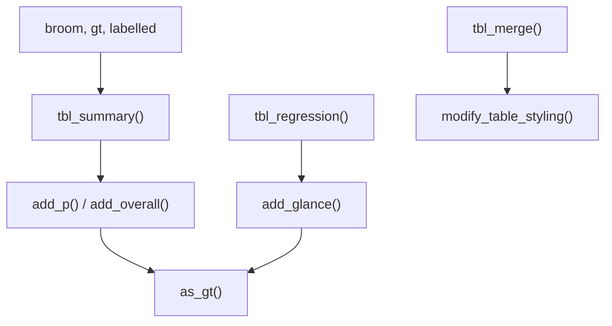

# ddsjoberg/gtsummary

> R package for building publication-ready summary and regression tables.

## The problem
Producing the "Table 1" of a paper or a model table takes a lot of formatting code.

## What it actually does
tbl_summary summarizes a dataset (detected variables, missing values), tbl_regression formats models (logistic regression, Cox), add_p adds tests, tbl_merge puts tables side by side, tbl_hierarchical produces adverse event tables. Each table is computed from an analysis results dataset (ARD) that is auditable via gather_ard. Export to gt, flextable, Word, HTML, LaTeX.

## How it is wired


## Trying it
```bash
# Dans R :
install.packages("gtsummary")
pak::pkg_install("ddsjoberg/gtsummary", dependencies = TRUE)
```

## Cost and gotchas
Free. License present but not recognized by GitHub: to be checked. Depends on gt, broom, cards and cardx.

## What it is not
Not a Python tool. Not statistical software: it formats results.

## Alternatives
gt, which it complements, and flextable for Word output.

## For you
Worth watching: very useful if you report results in R (clinical trials, regression), of no interest in a Python workflow.
