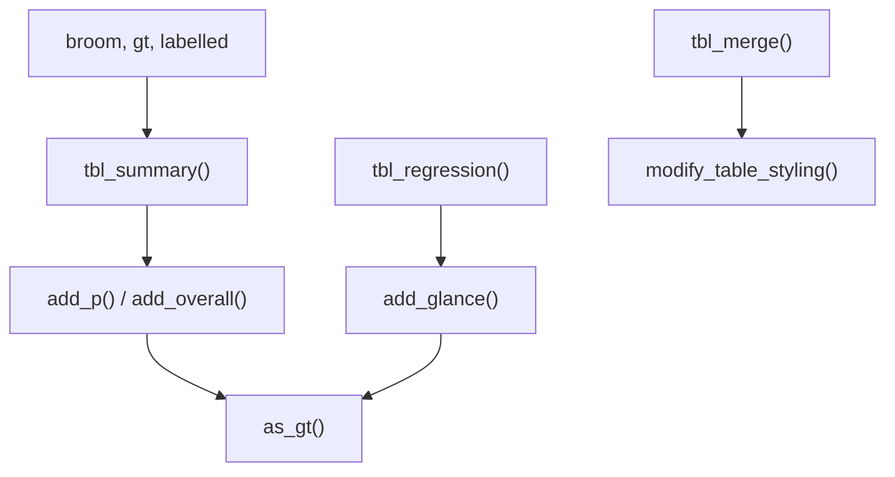

# ddsjoberg/gtsummary

> Paquet R pour fabriquer des tableaux de synthèse et de régression prêts à publier.

## Le problème
Produire le « Table 1 » d'un article ou le tableau d'un modèle demande beaucoup de code de mise en forme.

## Ce que ça fait vraiment
tbl_summary résume un jeu de données (variables détectées, valeurs manquantes), tbl_regression met en forme des modèles (régression logistique, Cox), add_p ajoute des tests, tbl_merge juxtapose, tbl_hierarchical produit des tableaux d'événements indésirables. Chaque tableau est calculé à partir d'un jeu de résultats d'analyse (ARD) auditable via gather_ard. Export gt, flextable, Word, HTML, LaTeX.

## Comment c'est branché


## Essayer
```bash
# Dans R :
install.packages("gtsummary")
pak::pkg_install("ddsjoberg/gtsummary", dependencies = TRUE)
```

## Coût et pièges
Gratuit. Licence présente mais non reconnue par GitHub : à vérifier. Dépend de gt, broom, cards et cardx.

## Ce que ce n'est pas
Pas un outil Python. Pas un logiciel statistique : il met en forme des résultats.

## Alternatives
gt, dont il est le complément, et flextable pour les sorties Word.

## Pour toi
À surveiller : très utile si tu rapportes des résultats en R (essais cliniques, régression), sans intérêt dans un flux Python.

