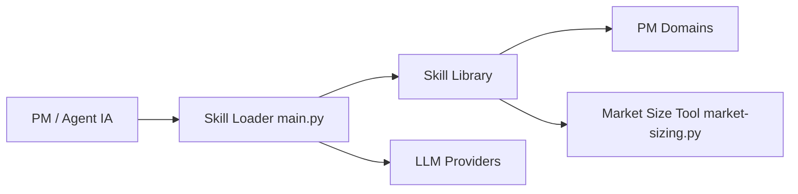

# deanpeters/Product-Manager-Skills

> Library of 77 product management skills for Claude, Codex and other agents.

## The problem
An agent asked to "write a PRD" produces a generic document, with no shared methodological framework.

## What it actually does
`SKILL.md` files split into three levels: components (deliverables), interactive (3 to 5 questions then recommendations) and multi-day workflows. Covers scoping, stakeholders, discovery, prioritization, writing, competitive intelligence, product end-of-life. An optional Streamlit sandbox calls Anthropic, OpenAI or Ollama.

## How it is wired


## Trying it
```bash
/plugin marketplace add deanpeters/Product-Manager-Skills
/plugin install product-manager-skills@pm-skills
pip install -r app/requirements.txt
streamlit run app/main.py
```

## Cost and gotchas
The sandbox uses your API keys (environment variables). The banner states CC BY-NC-SA 4.0: non-commercial use and share-alike, whereas GitHub does not identify the license.

## What it is not
Not code: methodological content. The section title says "70 Skills" while the rest says 77.

## Alternatives
None named in the README apart from MITRE ITK Skills (companion repository).

## For you
Watch: relevant for product scoping, outside the data/MLOps core, and the non-commercial clause forbids use in a company without agreement.
