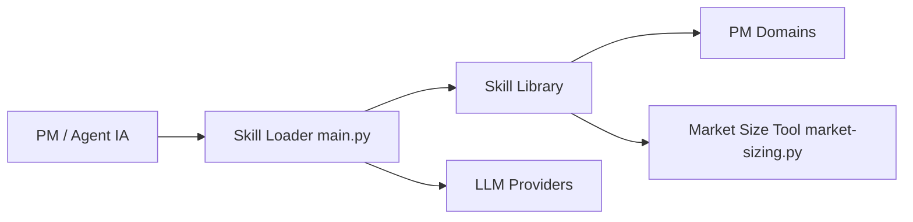

# deanpeters/Product-Manager-Skills

> Bibliothèque de 77 skills de gestion de produit pour Claude, Codex et autres agents.

## Le problème
Un agent à qui on demande « écris un PRD » produit un document générique, sans cadre méthodologique partagé.

## Ce que ça fait vraiment
Fichiers `SKILL.md` répartis en trois niveaux : composants (livrables), interactifs (3 à 5 questions puis recommandations) et workflows de plusieurs jours. Couvre cadrage, parties prenantes, découverte, priorisation, rédaction, veille concurrentielle, fin de vie de produit. Un bac à sable Streamlit optionnel appelle Anthropic, OpenAI ou Ollama.

## Comment c'est branché


## Essayer
```bash
/plugin marketplace add deanpeters/Product-Manager-Skills
/plugin install product-manager-skills@pm-skills
pip install -r app/requirements.txt
streamlit run app/main.py
```

## Coût et pièges
Le bac à sable utilise tes clés d'API (variables d'environnement). La bannière indique CC BY-NC-SA 4.0 : usage non commercial et partage à l'identique, alors que GitHub n'identifie pas la licence.

## Ce que ce n'est pas
Pas du code : du contenu méthodologique. Le titre de section dit « 70 Skills » quand le reste dit 77.

## Alternatives
Aucune nommée dans le README hors MITRE ITK Skills (dépôt compagnon).

## Pour toi
À surveiller : pertinent pour du cadrage produit, hors cœur data/MLOps, et la clause non commerciale interdit un usage en entreprise sans accord.

