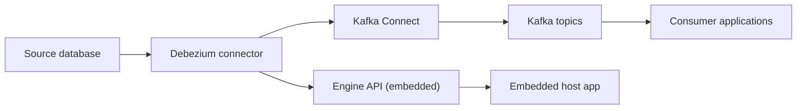

# debezium/debezium

> Change data capture (CDC) platform that streams every row change from a database to Kafka.

## The problem
Knowing that data has changed without proprietary triggers or double writes, and without losing events or their order.

## What it actually does
Kafka Connect connectors watch a database server, read the committed changes and write them to Kafka topics (one per table). Clients resume where they left off. An embedded engine lets you receive the events directly in the application, without Kafka. Transformations, converters and offset stores complete the whole.

## How it is wired


## Trying it
```bash
git clone https://github.com/debezium/debezium.git
cd debezium
./mvnw clean verify
./mvnw clean verify -DskipITs     # without Docker
./mvnw clean verify -Dquick       # artifacts only
```

## Cost and gotchas
Free. Integration tests require Docker. You need JDK 21, Maven and usually a Kafka infrastructure. The README mostly describes the build.

## What it is not
Not a turnkey ETL: it emits events, and consuming them is up to you. The generic connectors are more limited than those dedicated to a specific DBMS.

## Alternatives
No alternative named in the README.

## For you
Adopt it to feed features, indexes or warehouses in near real time: the CDC reference, Apache-2.0, strong activity.
