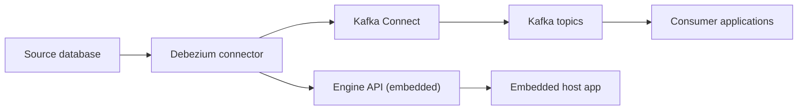

# debezium/debezium

> Plateforme de capture de changements (CDC) qui diffuse chaque modification de ligne d'une base vers Kafka.

## Le problème
Savoir qu'une donnée a changé sans triggers propriétaires ni double écriture, et sans perdre d'événements ni leur ordre.

## Ce que ça fait vraiment
Des connecteurs Kafka Connect surveillent un serveur de base de données, lisent les changements validés et les écrivent dans des topics Kafka (un par table). Les clients reprennent où ils s'étaient arrêtés. Un moteur embarqué permet de recevoir les événements directement dans l'application, sans Kafka. Des transformations, convertisseurs et stockages d'offsets complètent l'ensemble.

## Comment c'est branché


## Essayer
```bash
git clone https://github.com/debezium/debezium.git
cd debezium
./mvnw clean verify
./mvnw clean verify -DskipITs     # sans Docker
./mvnw clean verify -Dquick       # artefacts seulement
```

## Coût et pièges
Gratuit. Les tests d'intégration exigent Docker. Il faut JDK 21, Maven et en général une infra Kafka. Le README décrit surtout la compilation.

## Ce que ce n'est pas
Pas un ETL clé en main : il émet des événements, c'est à toi de les consommer. Les connecteurs génériques sont plus limités que ceux dédiés à un SGBD.

## Alternatives
Aucune alternative nommée dans le README.

## Pour toi
À adopter pour alimenter features, index ou entrepôts en quasi temps réel : référence du CDC, Apache-2.0, activité forte.

