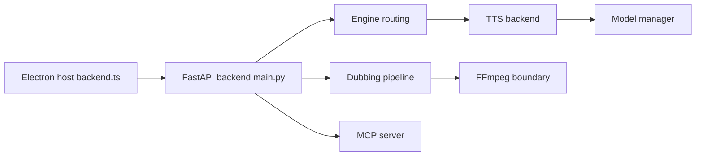

# debpalash/VoiceStudio

> Local office-based recording studio: cloning, text-to-speech, video dubbing, audiobooks, with API and MCP.

## The problem
Cloning a voice or dubbing a video often involves using paid cloud-based services that store your recordings.

## What it actually does
Appli Electron + backend FastAPI (`backend/main.py`, port 3900) that orchestrates multiple TTS engines (OmniVoice by default, CosyVoice, IndexTTS…).
Dubbing pipeline: ASR, diarization, translation, text-to-speech, quality control, export via FFmpeg.
Long-format rendering (audiobooks), dictation, SQLite job queue, event bus.
OpenAI-compatible API, MCP server, optional remote GPU workers.

## How it is wired


## Trying it
```bash
git clone https://github.com/debpalash/VoiceStudio.git
cd VoiceStudio
bun install
bun run setup:api
bun run dev
```

## Cost and gotchas
Material requirements vary depending on the engine; models available for download (with specific sizes and licenses). Analytics with user consent. Recent migration from Tauri to Electron.

## What it is not
Not a TTS engine in itself: a platform that orchestrates third-party engines. A young project (April 2026) initiated by an individual.

## Alternatives
No alternative engine is specified in the README (k2-fsa/OmniVoice is the default engine, not a competitor).

## For you
Interesting for the local API compatible with OpenAI and MCP; further investigation is needed before relying on it.
