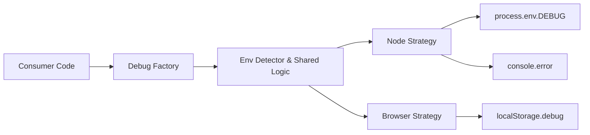

# debug-js/debug

> Small JavaScript utility for namespaced debug logs, for Node.js and browsers.

## The problem
Debugging `console.log` calls pile up and cannot be switched on or off finely per module.

## What it actually does
`require('debug')('http')` returns a log function bound to a namespace, enabled through the `DEBUG` variable (wildcards `*`, exclusions `-`).
Color per namespace, millisecond gap between calls, ISO timestamp outside a TTY.
Extensible printf formatters (`%o`, `%O`, `%j`…), redirectable output, `extend()`, dynamic `enable()`/`disable()`.
In the browser, configuration through `localStorage.debug`.

## How it is wired


## Trying it
```bash
npm install debug
```

## Cost and gotchas
Free, MIT; without `supports-color`, the color palette is reduced; no colors in a child process without `DEBUG_COLORS=1`.

## What it is not
Not a production logging system (levels, transports, aggregation).
Nothing for Python.

## Alternatives
No alternative named in the README.

## For you
Ignore: ubiquitous JavaScript dependency but outside your Python stack; worth knowing only to read the logs of Node tools.
