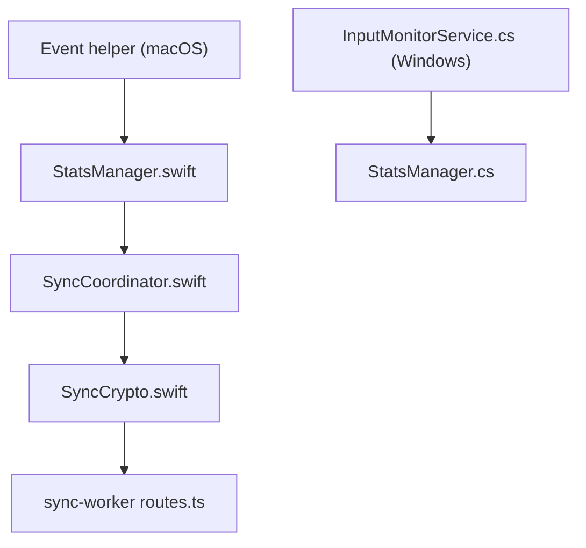

# debugtheworldbot/keyStats

> macOS and Windows menu bar application that counts keystrokes, clicks and mouse movements.

## The problem
Know how much you type and click per day, without recording what you write.

## What it actually does
Captures keyboard and mouse input, aggregates daily totals, stores them locally and shows them in a panel, a history and a keyboard heatmap. The README claims it does not record the typed text or click positions. End-to-end encrypted synchronization between devices is optional, via a server worker.

## How it is wired


## Trying it
```bash
brew tap debugtheworldbot/keystats
brew install keystats
scoop bucket add keystats https://github.com/debugtheworldbot/scoop-keystats
scoop install keystats
```

## Cost and gotchas
Free. On macOS, the Accessibility permission is mandatory; the application is not signed, hence re-authorizations on every reinstall. A keylogger by nature: check the code before trusting it.

## What it is not
Not a content recorder: counters only. Linux: just a download link.

## Alternatives
No alternative named in the README.

## For you
Ignore: personal statistics gadget, unrelated to data/AI; access to keyboard events deserves caution.
