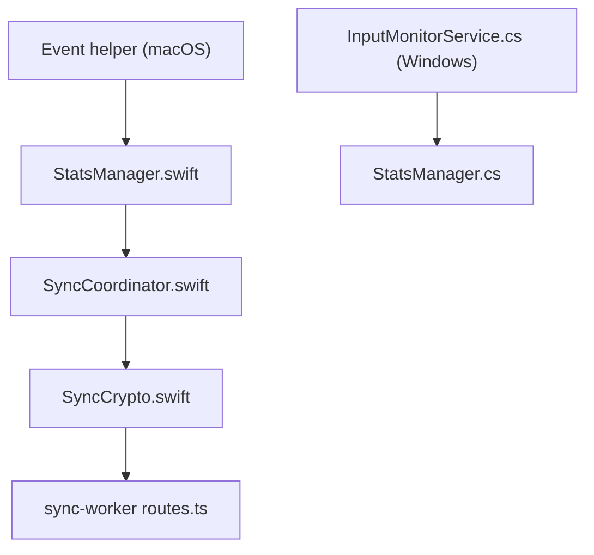

# debugtheworldbot/keyStats

> Application de barre de menus macOS et Windows qui compte frappes, clics et déplacements souris.

## Le problème
Savoir combien tu tapes et cliques par jour, sans enregistrer ce que tu écris.

## Ce que ça fait vraiment
Capture clavier et souris, agrège des totaux quotidiens, les conserve localement et les affiche en panneau, historique et carte thermique du clavier. Le README affirme ne pas enregistrer le texte saisi ni les positions de clic. Une synchronisation chiffrée de bout en bout entre appareils est optionnelle, via un worker serveur.

## Comment c'est branché


## Essayer
```bash
brew tap debugtheworldbot/keystats
brew install keystats
scoop bucket add keystats https://github.com/debugtheworldbot/scoop-keystats
scoop install keystats
```

## Coût et pièges
Gratuit. Sur macOS, permission Accessibilité obligatoire ; l'application n'est pas signée, d'où des réautorisations à chaque réinstallation. Un enregistreur de touches par nature : vérifier le code avant confiance.

## Ce que ce n'est pas
Pas un enregistreur de contenu : seulement des compteurs. Linux : simple lien de téléchargement.

## Alternatives
Aucune alternative nommée dans le README.

## Pour toi
Ignorer : gadget de statistiques personnelles, sans rapport avec data/IA ; un accès aux événements clavier mérite méfiance.

