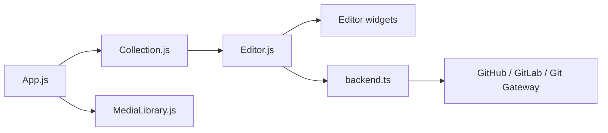

# decaporg/decap-cms

> In-browser CMS for editing the content of a static site stored in Git.

## The problem
Non-developers do not want to edit Markdown files in Git to update a static site.

## What it actually does
Single-page application mounted at the site's `/admin`. A YAML file describes the content model; after logging in, the user creates or edits entries through a widget-based editor, a media library and an optional editorial workflow. Saves go through a Git backend (GitHub, GitLab, Git Gateway, others). Formerly Netlify CMS, renamed in 2023.

## How it is wired


## Trying it
```bash
# Aucune commande exacte dans le README : installation rapide
# via un fichier HTML + une config chargés depuis un CDN (voir le Quick Start Guide).
```

## Cost and gotchas
Free; an authentication service and a hosted Git repository are required. Side commercial offering (Decap Turbo, expert services). 593 open issues.

## What it is not
Not a CMS with a database: content remains files in Git.

## Alternatives
No alternative named in the README.

## For you
Little related to data/AI; useful if you publish a docs site or static blog with several people, otherwise pass.
