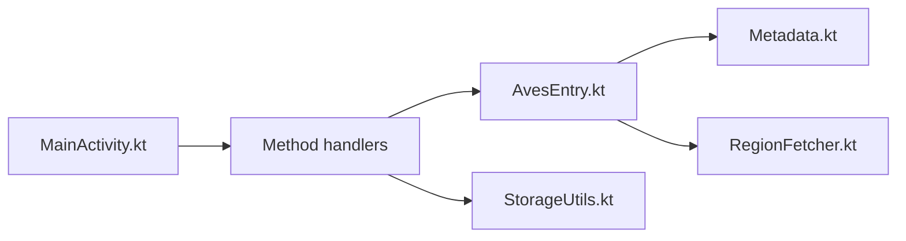

# deckerst/aves

> Flutter Android gallery and metadata explorer, for photographers and media enthusiasts.

## The problem
Standard galleries handle exotic formats, metadata, and navigation by place or tag poorly.

## What it actually does
Reads JPEG, MP4, multipage TIFF, SVG, old AVI; detects motion photos, panoramas, 360° videos, GeoTIFF. Navigation by albums, tags, maps. Integrates with Android (widgets, screensaver, global search, media picker, TV).

## How it is wired


## Trying it
```
scripts/apply_flavor_play.sh
./flutterw run -t lib/main_play.dart --flavor play
```
You also need `android/key.properties` to sign the build.

## Cost and gotchas
Free. Extended permissions, including MANAGE_MEDIA. The project does not accept PRs.

## What it is not
Not a server-side photo management tool.

## Alternatives
No alternative cited in the README.

## For you
Ignore: mobile gallery, outside the data / AI / MLOps scope.
