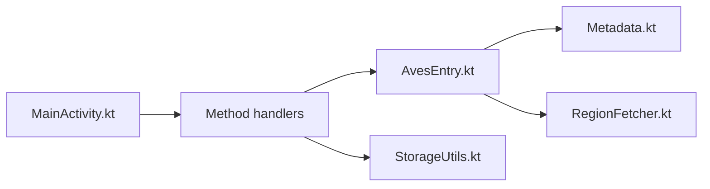

# deckerst/aves

> Galerie Android et explorateur de métadonnées en Flutter, pour photographes et amateurs de médias.

## Le problème
Les galeries standards gèrent mal formats exotiques, métadonnées et navigation par lieux ou tags.

## Ce que ça fait vraiment
Lit JPEG, MP4, TIFF multipage, SVG, AVI anciens ; détecte photos animées, panoramas, vidéos 360°, GeoTIFF. Navigation albums, tags, cartes. S'intègre à Android (widgets, économiseur d'écran, recherche globale, sélecteur de médias, TV).

## Comment c'est branché


## Essayer
```
scripts/apply_flavor_play.sh
./flutterw run -t lib/main_play.dart --flavor play
```
Il faut aussi `android/key.properties` pour signer le build.

## Coût et pièges
Gratuit. Permissions étendues, dont MANAGE_MEDIA. Le projet n'accepte pas de PR.

## Ce que ce n'est pas
Pas un outil de gestion de photos côté serveur.

## Alternatives
Aucune alternative citée dans le README.

## Pour toi
À ignorer : galerie mobile, hors périmètre data / IA / MLOps.

