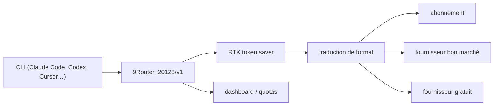

# decolua/9router

> Local proxy that routes coding tools to 40+ LLM providers with automatic fallback.

## The problem
A quota hit in the middle of a session stops the work; an unused quota is lost at the end of the month.
Tool outputs (`git diff`, `grep`, `ls`) fill the prompt and cost a lot in input tokens.

## What it actually does
Exposes a local OpenAI endpoint (`http://localhost:20128/v1`) and translates between OpenAI, Claude, Gemini, Cursor, Vertex and Ollama formats.
RTK compresses `tool_result` before sending (git-diff, grep, find, tree, dedup-log filters); advertised at 20-40% savings.
Three-tier fallback: subscription → cheap provider → free, with quota tracking and OAuth refresh.
Optional prompt injectors (Caveman, Ponytail) to shorten outputs; dashboard, logs, analytics, cloud sync.

## How it is wired


## Trying it
```bash
npm install -g 9router
9router
cp .env.example .env
npm install
PORT=20128 NEXT_PUBLIC_BASE_URL=http://localhost:20128 npm run dev
pip install "headroom-ai[proxy]"
headroom proxy --port 8787
```

## Cost and gotchas
The software charges nothing, but the dashboard "costs" are fictitious: only the providers bill you.
The free offers mentioned are shrinking: Kiro capped at ~50 credits/month, iFlow and Qwen Code discontinued, Gemini CLI closed.

## What it is not
It is not unlimited free access, despite the title: each free tier has its cap and changes without notice.
It is not auditable as is: the repository's package is private (`9router-app`) and the README declares no license.
It is not neutral for your data: all your code traffic goes through a proxy, with a cloud sync option.
The README provided here is truncated after the start of the setup guide.

## Alternatives
Headroom (`headroom-ai`): context compression proxy, usable on its own via `/v1/compress`.
OpenRouter: multi-provider routing, cited among the API-key providers.

## For you
Avoid in a professional context: sending client code through an unlicensed third-party proxy is not defensible.
