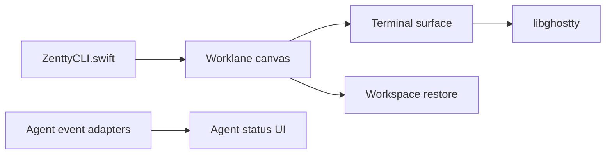

# dedene/zentty

> Native macOS terminal, built on Ghostty, for working with several coding agents in parallel.

## The problem
With several agents in terminal tabs, you can't see which one is waiting for approval or still working.

## What it actually does
Swift/AppKit terminal on libghostty, with "worklanes" (scrolling columns of panes), a command palette and session restoration. The sidebar and menu bar show agent status (running, waiting, approval), the number of sub-agents, local ports and PR status. It detects task runners and pastes files into an ssh session. An embedded `zentty` CLI drives everything.

## How it is wired


## Trying it
```bash
brew install --cask zentty
./scripts/build_ghosttykit.sh
xcodebuild -project Zentty.xcodeproj -scheme Zentty -destination 'platform=macOS' build
```

## Cost and gotchas
Free, macOS 14+. Building requires Xcode, `zig` and `gettext`. Project under active development with possible breaking changes. GPL-3.0; the Zentty trademark is protected separately.

## What it is not
Not an agent or an IDE integration: it is a terminal. macOS only.

## Alternatives
Ghostty: the terminal it is built on, without agent management.

## For you
Watch: interesting if you work a lot with agents on Mac, but switching terminals is a personal choice, and the project moves fast.
